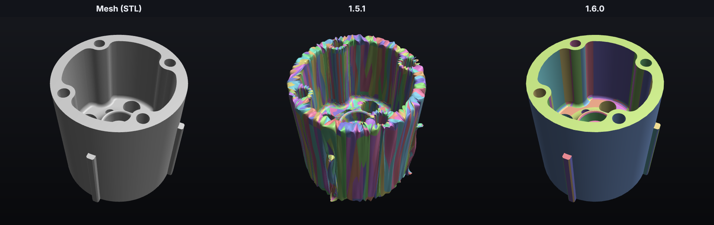
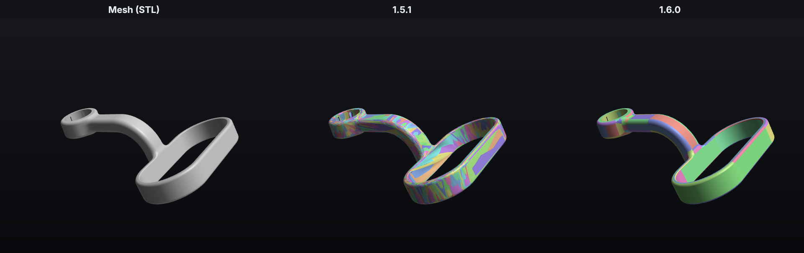
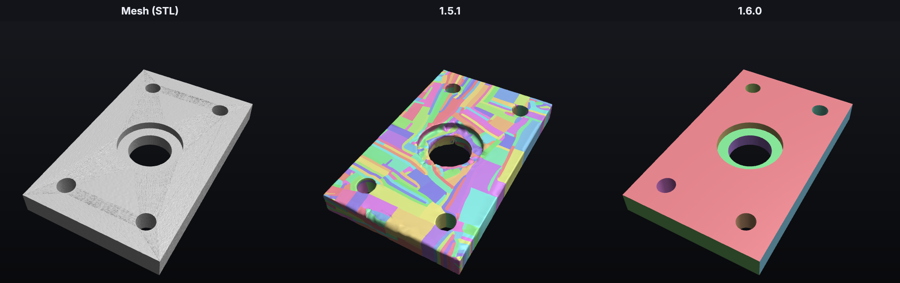
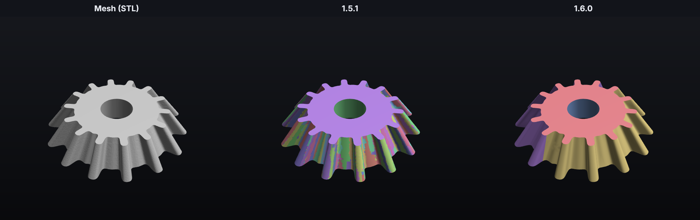
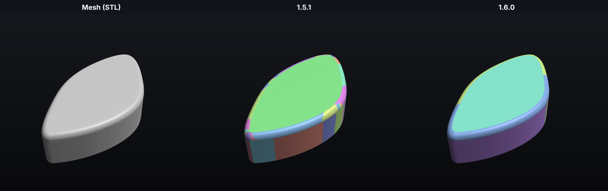
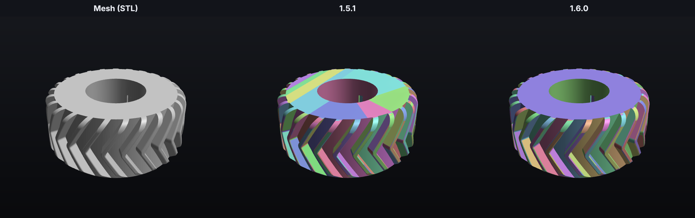

# Manifold Mesh Mix

An app for **macOS, Windows and Linux** that turns 3D-printing meshes (**STL, 3MF, OBJ, PLY**) into **editable STEP files** you can open in Fusion, SolidWorks, FreeCAD or Onshape. The STEP files are made of real CAD surfaces: flat faces, holes and cylinders, cones, spheres, fillets, gear teeth and smooth freeform surfaces. You can select, measure and edit them like a part you modelled yourself.

It's made for real-world files, including messy ones: CAD exports, coarse OpenSCAD models, noisy 3D scans, sculpts and slicer projects. Every mesh is checked and repaired first. Every result is compared with the mesh it came from, so a wrinkled, dented or patchwork shape is never saved when a closer one can be made. Every STEP file is opened again and checked after it is saved.

<a href="https://buymeacoffee.com/tunathefirst"></a>

## What's new in 1.6

1.6 rebuilds the CAD side of the converter. In 1.5.1, mechanical parts often came out as hundreds or thousands of small freeform patches, sometimes crumpled or with flaps. In 1.6 they come out as the few clean faces a CAD program would make. In each picture below, every face has its own color: fewer, larger colors mean a cleaner, more editable part.


*A printed hub (a user's problem file). 1.5.1 gave up on CAD and saved 2,243 smooth patches that crumple around the holes. 1.6.0 saves 214 CAD faces, all within 0.08 mm of the mesh.*


*A headrest mount made in OpenSCAD (a user's problem file): 2,156 patches in 1.5.1, 182 faces in 1.6.0. The bent arm is a few large faces instead of a patchwork.*


*A noisy scan of a flat plate with holes (test model). 1.5.1 followed the noise and left a lumpy surface, worst around the counterbore. 1.6.0 sees through the noise: 13 faces with the counterbore as true flat faces and cylinders.*


*A bevel gear (test model): 662 strips in 1.5.1, 5 faces in 1.6.0. The tapered teeth are swept faces instead of strips.*


*A cam with a fillet along its curved outline (test model): 55 pieces in 1.5.1, 8 in 1.6.0. The fillet follows the curve in a few long faces instead of many small pieces.*


*A tractor tire (a user's problem file): 1,186 faces in 1.5.1, 610 in 1.6.0, with straight borders between the tread faces.*

**The big changes** (the [release notes](.github/release-notes/v1.6.0.md) explain each one in detail):

- **Every conversion is checked against the mesh, not just for validity.** The app measures how far the result is from the mesh everywhere, both ways, and which way the surface faces. Different kinds of meshes get their own rules: a clean CAD export, a coarse OpenSCAD model and a noisy scan aren't judged the same way. When a result only just passes, a finer second check decides, and the other method is tried too so the closer result is kept. The app says when it does this, so you know why a file takes longer.
- **New kinds of CAD faces: swept surfaces and fillets.** Straight and helical gear teeth, tapered bevel-gear teeth, worm threads, tire treads and bent arms become one swept face each instead of hundreds of patches. Fillets along curved edges become one face that follows the curve.
- **Clean borders between faces.** Faces used to meet along saw-tooth borders that followed the mesh's triangles, which left jagged edges, folded faces and thin slivers. Borders are now straightened and smoothed, and leftover slivers are joined to their neighbours.
- **Much better with bad meshes.** Noisy scans keep their real flat faces instead of falling apart into thousands of pieces. Coarse exports (few, long triangles) are judged by their own faceting. Hole fills in the mesh check never cut through the part. Parts that touch along an edge each stay closed.
- **Files that are right in every program.** Every face is written to STEP, read back and checked before the file is saved. Faces that would break in the saved file (STEP doesn't keep everything OpenCASCADE keeps in memory) are built again.
- **Two versions when no method fits.** If no method follows the mesh everywhere, the app keeps both the closest result and a valid one, and you pick (**Closest to the mesh** or the other version).
- **Better preview and progress.** Faces OpenCASCADE can't mesh are no longer missing from the STEP preview. The queue shows each step of a conversion, such as a second check or another method being tried. Long lists of touching parts in 3MF projects are cut short so the buttons stay on screen.

## Download

Get the newest version from the [Releases page](https://github.com/TUNA-THE-FIRST/Manifold-Mesh-Mix/releases/latest):

| System | File | Notes |
|---|---|---|
| **macOS** 14+ (Apple silicon) | `ManifoldMeshMix-<version>-macOS-arm64.zip` | Unzip and drag **Manifold Mesh Mix** into Applications. The app isn't notarized, so the first time, right-click it and choose **Open**. |
| **Windows** 10/11 (64-bit) | `ManifoldMeshMix-<version>-Windows-x64-Setup.exe` | Installs just for your user account (no administrator password). Windows SmartScreen may warn about an unknown publisher the first time: click **More info → Run anyway**. |
| **Linux** (x86-64; Ubuntu 22.04, Fedora 36, Debian 12 or newer) | `ManifoldMeshMix-<version>-Linux-x86_64.AppImage` | Make it executable (`chmod +x`, or Properties → Permissions) and double-click it. If it doesn't start, install `libfuse2` (Ubuntu: `sudo apt install libfuse2`). **File → Add to Applications Menu** puts it in your app menu and in "Open With" for meshes. |

### Updates

Every version can update itself. Click the **⬇ button** next to the app name (or **Check for Updates…** in the menu or in Preferences/Settings). The app looks up the newest release on GitHub, downloads the file for your system, checks it against the release's checksums, installs it and opens again. A few seconds after opening, the app also checks once by itself and shows **Version X is available** under the app name; it never installs anything without a click (turn the check off in Preferences/Settings).

- **Windows:** the installer runs silently and the app restarts.
- **Linux:** the AppImage replaces itself (the folder it is in must be writable) and restarts.
- **macOS:** the app replaces itself in its folder (normally Applications) and restarts. If macOS asks, allow Manifold Mesh Mix under **System Settings → Privacy & Security → App Management**.

## Using it

1. Open **Manifold Mesh Mix** (Applications on the Mac, the Start menu on Windows, the AppImage on Linux).
2. Drop files or whole folders onto the window, or click the drop area to browse. You can also right-click a file and choose **Open With → Manifold Mesh Mix** (Finder on the Mac, Explorer on Windows).
3. Pick a **preset** (Auto is fine for almost everything) and set the **Speed ↔ Quality** slider.
4. Press **Convert** (⌘↩ on the Mac, Ctrl+Enter on Windows/Linux). The STEP files stay inside the app until you export them; nothing is saved into your folders yet.
5. Click a file in the queue to compare the **Mesh** and **STEP** views. The STEP view shows the body the way a CAD program does; the palette button gives every face its own color, so you can see how the surfaces were split up.
6. Press **Export…** (⌘E / Ctrl+E, or **Export All** ⇧⌘E / Ctrl+Shift+E). The export window shows the file names, where they go (by default a **STEP Files** folder next to each original) and whether existing files are replaced. If replace is off and a file with the same name is already there, the app asks whether to replace it or save under a new name.
7. A green **File checked** badge means the saved STEP file was read back and is a valid solid with the mesh's volume, and that its surface follows the mesh (hover over the badge to see how closely, for example "99.9% of the surface is within 0.13 mm of the mesh"). Otherwise the app lists each problem it found in plain words (for example gaps in the surface, a part that isn't a closed solid, or a volume that doesn't match the mesh), or shows **Doesn't match the mesh everywhere** when no method followed the mesh closely enough. In that case the app keeps two versions, the one closest to the mesh and a valid one, and shows **Two versions were made** above the preview: the one you pick is shown and exported.
   **Automatic repair.** If reading the file back finds small errors (faces whose edges don't line up, small gaps, a solid whose surfaces cross), the app repairs the file the way CAD programs like Fusion do when they import one, and checks it again. Then the badge says **Repaired automatically**, so the file is clean in every program, not just in CAD programs that heal files themselves. The repair only runs when there is a problem, and a repaired version is kept only if it reads back better with the same shape and volume. If a part still has errors the repair can't fix, the app converts just that part again another way: smooth surfaces instead of CAD faces, CAD faces instead of smooth surfaces for mechanical parts, or denser smooth surfaces for organic ones. It uses the new version only if that checks out clean. It tells you when it did. Problems in the mesh itself (holes, missing pieces) can't be repaired this way and are still listed.

### Mesh check

Every file is checked when you add it, and again right before it's converted. The check looks for the problems that make 3D-printing meshes hard to turn into solids, fixes what it can, then checks the fixed mesh again from scratch. While a file is read, the queue and the preview show the step it is on (for example "Looking for hidden internal walls" or "Filling holes"), with a progress bar. The **Mesh** view shows the result above the file name (**Mesh is clean**, **Mesh fixed**, **Your choice needed** or **Mesh has problems**) and lists each problem in plain words with what was done about it.

| Problem | What the app does |
|---|---|
| Triangles with broken coordinates, squashed flat, or duplicated | Removes them. |
| Paper-thin walls hidden inside a part (left where shapes were glued together, for example by slicer tools that merge parts into one mesh) | Removes them, so the outer surface is one clean piece. |
| Tiny cracks between edges that should be joined | Joins them. |
| Triangles facing the wrong way, or whole parts inside out | Turns them around. |
| Points where the surface touches itself at a single corner | Separates them. |
| Holes and tangled edges (an edge shared by 3 or more triangles) | Fills and untangles them. Big holes are filled with a simple surface, and the app says so. |
| The surface passing through itself | Repairs it only where that doesn't change the shape: every repaired spot is compared with the original solid, and spots where material would be added or removed are put back. What's left is listed. |
| Pieces that overlap each other | Asks you: they stay separate solids unless you click **Merge Overlapping Pieces**, which joins them into one. |
| A surface with no thickness, or holes too big to fill | Converts it as a surface instead of a solid, and tells you. |
| A model that's tiny or huge | Notes that it may be in inches or meters, so you can change **Units**. |

**Save Fixed Mesh…** saves the checked and fixed mesh as an STL or 3MF (one object per part), for example to print it from your slicer. Nothing in your original file changes.

### When something goes wrong

If a conversion fails, the app says what went wrong and **why**, in plain words (for example that the file itself is the problem, or that the computer ran out of memory). **Save Report…** writes a small text file to send with a bug report ([open an issue](https://github.com/TUNA-THE-FIRST/Manifold-Mesh-Mix/issues) and attach it). It has the app and system versions, your settings, the mesh check, the error and its technical details, and the log. It doesn't have the mesh itself, and the file's folder and your user name are removed from it.

### Presets

| Preset | Best for | What you get |
|---|---|---|
| **Auto** | Everything | Checks every part and picks CAD or Smooth for it. After converting, the preset Auto used is marked **Auto used** in its own color. |
| **CAD** | Mechanical parts, brackets, enclosures, wheels | Planes, holes, cylinders, cones, fillets (tori) and spheres as exact CAD faces you can select, measure and edit. Anything else becomes fitted NURBS. |
| **Smooth** | Sculpts, figurines, organic shapes, scans | Large smooth NURBS surfaces fitted to the mesh. |
| **Precise** | When accuracy matters most | Like Auto, but with a tighter tolerance and more detail. |

### 3MF projects (Bambu Studio, OrcaSlicer, Snapmaker Orca, PrusaSlicer)

The app reads the actual parts from slicer project files:
- **Modifiers and support blockers/enforcers are skipped.** Only real printable parts are converted.
- **Copies on the plate are converted once**, in their original orientation and position (the same coordinates as the STL they came from). Scaling you applied in the slicer is kept.
- **Split to parts (on by default):** every part becomes its own STEP file, named *Project - Part.step*, like "Split to parts" in the slicer. The preview shows one tab per part, so you can look at each part's mesh and STEP separately. Turn it off (the **Split to parts** button above the preview, or **Split 3MF projects into parts** in the settings) to get one STEP file with all parts as named bodies.
- To keep the plate arrangement instead, set **Advanced → 3MF projects → Whole build plate** (this keeps all parts in one file).
- **Parts that touch each other** (a two-color print, a soft liner in a hard mount) are found when the file is read, and the app asks: **Split to Parts** keeps them apart, **Merge Into One** joins them into one solid with an exact union (no leftover walls where they touched). **Merge Touching Parts** in the Mesh view changes it later.

### Speed ↔ Quality

Higher quality tightens the fitting tolerance and adds surface detail, but takes longer.

**Auto quality** (with the Auto preset, on by default): each file gets its own quality from its size, because small meshes are quick even near the top of the slider while very big ones would take hours. Under 50,000 triangles 90%, up to 300,000 80%, up to 1 million 70%, up to 3 million 60%, and 50% above that. The slider shows the quality picked for the selected file. Moving the slider switches to one quality for every file; the **Auto** button next to it switches back.

**Best quality keeps fine detail.** In the *Best quality* part of the slider (85% and up), organic shapes get more surfaces the denser the mesh is, so sculpted texture like cracks, scales and tool marks survives. At the far right the surfaces stay within a few hundredths of a millimeter of a typical sculpt. Dense meshes then make much bigger STEP files and take a lot longer: a 2-million-triangle bust took about 20 minutes and made a 130 MB file, instead of about 8 minutes and 25 MB. When that's about to happen, a warning under the slider gives the expected file size. It needs a few GB of memory. A **Smooth surface limit** (Advanced) turns it off.

## Building from source

All three versions share the conversion engine in `engine/`. The version number lives in `VERSION`.

### macOS

Needs macOS 14 or newer on Apple silicon, the Xcode command line tools and Python 3.12.

```
python3.12 -m venv .venv
.venv/bin/pip install -r requirements.txt
./build.sh            # builds dist/Manifold Mesh Mix.app (Swift app + bundled engine)
./build.sh --install  # also copies it to /Applications
./build.sh --zip      # also makes the release download
```

### Windows and Linux

One Qt (PySide6) app in `desktop/` builds both. Needs Python 3.12; Windows also needs [Inno Setup 6](https://jrsoftware.org/isinfo.php) for the installer.

```
python3.12 -m venv .venv                       # Windows: py -3.12 -m venv .venv
.venv/bin/pip install -r requirements.txt -r desktop/requirements.txt
.venv/bin/python desktop/build.py               # Windows: .venv\Scripts\python desktop\build.py
```

This builds `dist-desktop/ManifoldMeshMix/` (the app with its engine) and the installer (Windows) or AppImage (Linux). To run the app straight from the source code: `.venv/bin/python -m mmm_app` inside `desktop/`.

### Releases

Pushing a tag such as `v1.0.1` (matching `VERSION`) makes GitHub Actions build and test all three versions and publish a release with their downloads and `SHA256SUMS.txt`, which the apps' updaters use. Every push runs the same builds and tests (`.github/workflows/build.yml`).

### Where things are

- `engine/mmm/`: the Python conversion engine (OpenCASCADE via OCP). Run it directly with `.venv/bin/python engine/mmm_engine.py convert part.stl --preset auto`.
- `app/Sources/`: the SwiftUI Mac app. `app/Tests/update_test.py` tests its self-update.
- `desktop/mmm_app/`: the Windows/Linux app; `desktop/packaging/`: its installer and AppImage files; `desktop/tests/`: unit tests, the scripted self-test checker and update tests.
- `tests/`: test-model generator (`make_models.py`, creates `tests/models/`), test suite (`run_suite.py`, with `render.py` for its pictures) and `measure_detail.py`, which measures how closely a STEP file follows its mesh.

### How the engine works (short version)

- **Mesh check** (`engine/mmm/meshcheck.py`): runs on every part before converting. Each problem has its own detector (zero-volume pieces and coincident opposite sheets for internal walls, union-find over corner fans for pinched points, a uniform grid with exact triangle–triangle tests for self-intersections, Manifold booleans for overlapping pieces) and is fixed in an order where each fix makes the next one easier. MeshFix repairs crossing surfaces, but its result is compared with the original patch by patch, using winding numbers to tell inside from outside, and only kept where no material is added or removed. A second pass (`verify_bodies`) checks the fixed mesh again without fixing anything; the engine's `fix` command saves the fixed mesh.

- **CAD:** the mesh is segmented by region growing with robust, area-weighted fits of planes, cylinders, cones, spheres and tori. Simpler surface types are preferred, and fits are checked between mesh vertices, not just at them, within the mesh's own faceting (measured from its curved areas; shallow creases don't count). Coarse cylinders made of a few long facets (typical of OpenSCAD) are recognised from the edges that run along them.
  - **Swept surfaces** (`engine/mmm/sweep.py`): leftover areas are tested for a motion that leaves them unchanged: a straight pull (extrusions, straight gear teeth), a turn about an axis, a screw motion (helical teeth, worm threads, treads) or a screw that also shrinks (tapered bevel-gear teeth). The motion comes from the surface normals, which are all square to it (Pottmann & Randrup); the profile is then fitted once and swept. **Fillets along curved edges** (`engine/mmm/fillet.py`) become one pipe surface around the measured spine instead of the many small tori and cylinders the segmenter cuts them into. A new surface is only kept where it is no worse than what it replaces.
  - **Clean borders:** jagged borders between regions are straightened by a minimum cut through the triangles that fit both surfaces, then smoothed; slivers left behind join their neighbours, and a border move that would leave a strip narrower than two tolerances is skipped. Edge curves are checked so they never fold back.
  - What's left is split into height-field patches and fitted with trimmed B-splines. Edges are fitted curves shared by both faces; wrap-around faces get proper seams and poles. Before the shape is accepted, its faces are written to STEP and read back, and faces that come back broken are built again.
- **Smooth:** quad remesh (Instant Meshes, with a decimate → Manifold-clean → quad-split fallback), then Catmull–Clark-style bicubic patches (Loop–Schaefer ACC) least-squares fitted to the mesh. Regular patch areas are then merged into large B-spline faces.
- **Shape check against the mesh** (`engine/mmm/fidelity.py`): every result is tessellated again (finer than the fit tolerance) and compared with the mesh both ways: exact point-to-triangle distances from evenly spread points on the mesh to the shape (missing material, dents) and from the shape to the mesh (bulges, flaps), plus the direction the surface faces at each point (wrinkles keep close to the mesh but tilt it). A result follows the mesh when 99% of its surface is within 3 tolerances, 99.9% within 8, and almost none faces the wrong way. Each kind of mesh has its own rules, picked by measuring the mesh (`mesh_kind`): **clean** meshes are judged as they are; **coarse** ones (an OpenSCAD 16-sided circle) get a tolerance as large as their own faceting; **scans** get a tolerance as large as their noise, and only whole patches facing the wrong way count, not single noisy points. Each verdict has a certainty: near a limit, or with a spot further off than the mesh's coarseness explains, a finer second check decides, and Auto tries the other method too and keeps the closer result. The CAD builder uses the same measure face by face: a face that strays is fitted again as a freeform face, and a freeform face that still strays becomes flat faces made from its own triangles. The pipeline uses it to choose between methods: one that follows the mesh beats one that is merely valid, and when nothing smooth follows a small mesh (up to 20,000 triangles), it is saved with flat faces exactly like the mesh.
- Every result is checked with OpenCASCADE's shape analyzer before it's written, and the saved file is read back and checked again. When that finds problems, `engine/mmm/repair.py` opens the saved file and saves it again (as a CAD program would), then tries shape healing and sewing, keeping each step only if the file reads back better with the same volume. If problems remain, the broken parts are converted again another way (`convert_alt` in `pipeline.py`). The STEP file also stores each edge's 2D curve on its faces, so CAD programs rebuild every face exactly as it was checked (the test suite reads each file back and compares volumes).

## Support the project

Manifold Mesh Mix is free. If it saves you time, you can [buy me a coffee](https://buymeacoffee.com/tunathefirst): it helps pay for the AI credits that go into building and improving it. **Help → Support the Project** in the app opens the same page.

## License

Copyright © 2026 Tuna-The-First and Claude (Anthropic's AI assistant).

Manifold Mesh Mix is free and open-source software, licensed under the **GNU Affero General Public License v3.0** (AGPL-3.0). See [LICENSE](LICENSE) for the full text.

In short: you may use, study, change and share it. If you give the app (or a changed version of it) to others, or run a changed version for others over a network, you must make its source code available to them under the same license. It comes with no warranty.

It bundles other open-source software; see [THIRD_PARTY_NOTICES.md](THIRD_PARTY_NOTICES.md).

